<p align="center">
  
</p>

<h1 align="center">claude-muslim</h1>

<p align="center">
  Thikr, athkar, prayer times and the Quran, inside Claude Code.<br>
  In the desktop app and the terminal.
</p>

<p align="center">
  <a href="https://abdelrahman.ai/muslim/"></a>
</p>

<p align="center">
  <a href="#features">Features</a> ·
  <a href="#install">Install</a> ·
  <a href="#get-started">Get started</a> ·
  <a href="CHANGELOG.md">Changelog</a>
</p>

## Features

| | Feature | What it does |
| :---: | --- | --- |
| 📿 | **Thikr line** · `/thikr` | A short thikr in Claude's working line while it works, and a closing word when a turn ends. |
| 🌅 | **Athkar** · `/athkar` | Morning, evening and after-salah athkar from Hisn al-Muslim, in a reader above the prompt that counts with you. |
| 🕌 | **Prayer times** · `/salah` | The next prayer under the prompt, a countdown, and an athan moment when it comes in. Calculated on your machine. |
| 📖 | **Quran** · `/quran` | A recitation player with complete Hafs recordings. Desktop. |
| ☾ | **Muslim pane** · `/muslim` | Today's prayers, the Quran player, athkar progress and every setting in one pane. Desktop. |

## Install

It installs for every project, in the desktop app and the terminal.

**Desktop app or any Claude session:** paste this to Claude. It installs muslim, or updates it if it is already installed.

```text
Set up the Claude Code plugin "muslim":
1. Run `claude plugin marketplace list`. If `claude-muslim` is not listed, run `claude plugin marketplace add abdelrahmanzied/claude-muslim --sparse .claude-plugin plugin`; otherwise run `claude plugin marketplace update claude-muslim`.
2. Run `claude plugin list`. If `muslim@claude-muslim` is not installed, run `claude plugin install muslim@claude-muslim`; otherwise run `claude plugin update muslim@claude-muslim`.
3. When done, tell me in one line to run /reload-plugins, or to start a new session.
```

**Terminal:** in your shell, not inside Claude Code:

```bash
claude plugin marketplace add abdelrahmanzied/claude-muslim --sparse .claude-plugin plugin && claude plugin install muslim@claude-muslim
```

After installing, run `/reload-plugins` once in the session (desktop app or terminal) so muslim's settings can be saved.

## Get started

| Command | |
| --- | --- |
| `/muslim` | Open the Muslim pane (desktop), or see your settings (terminal) |
| `/muslim help` | Every command |
| `/muslim demo` | Play thikr, athkar, salah and the desktop pane tour |
| `/muslim update` | Update to the latest version |
| `/muslim feedback` | Report a bug or send an idea |

To remove it, run in your shell:

```bash
claude plugin uninstall muslim@claude-muslim && claude plugin marketplace remove claude-muslim
```

> [!NOTE]
> Some terminals don't join Arabic letters or show them right to left. The first time muslim opens in a terminal, it asks which Arabic sample reads right, and remembers the answer. To pick again: `/muslim terminal-arabic`.

## Privacy

The first time muslim starts on a computer, it sends one anonymous request to `abdelrahman.ai` so we know how many people use it: the muslim version, `terminal` or `desktop`, and `mac`, `linux` or `windows`. Nothing else: no name, id, path, prayer place or settings. It is never sent again from that computer. The total is shown on [abdelrahman.ai/muslim](https://abdelrahman.ai/muslim/) and in the badge above. To send nothing, set `DO_NOT_TRACK=1` or `CLAUDE_CODE_DISABLE_NONESSENTIAL_TRAFFIC=1` before muslim's first start.

## Contributing

Ideas, bugs and fixes are welcome: see [CONTRIBUTING.md](CONTRIBUTING.md). Security problems go to [SECURITY.md](SECURITY.md), never a public issue.

This repository is the only official source of the `muslim` plugin. Copies elsewhere are not maintained by us.

## License

[MIT](LICENSE)
